# jetson_ai_modbus_rtu 아키텍처

NVIDIA 계층 안에서 이 애플리케이션이 어디에 위치하는지와, 실행 프로세스의
장애 경계·상태 소유권을 설명하는 상위 수준 문서임. 세부 프레임 처리 순서는
`PIPELINE.md`, 설치와 운영 명령은 `README.md`와 `USAGE.md`를 참고함.

핵심 요약은 아래와 같음.

> `ds_camera`는 Linux for Tegra 위에서 JetPack SDK와 DeepStream SDK를 사용하는 Python 기반 User APP임.

---

## 0. Notion에서 flowchart 코드 안 보이게 하는 방법

Markdown 자체에는 Mermaid flowchart 코드를 숨기고 그림만 보여주는 표준 기능이 없음.

Notion에서 가장 깔끔한 방법은 아래 중 하나임.

1. Notion Mermaid 코드블록으로 붙여넣기  
   Notion이 Mermaid를 렌더링하면 코드 대신 그림처럼 보임.

2. Mermaid Live Editor 등에서 SVG/PNG로 export 후 이미지로 업로드  
   이 방식이면 코드가 아예 보이지 않음.

3. 코드가 보여도 덜 거슬리게 하려면 Notion Toggle 안에 Mermaid 코드블록을 넣기  
   다만 이 경우 Toggle을 열어야 그림을 볼 수 있음.

이 문서는 우선 Notion Mermaid 렌더링 기준으로 작성함.  
긴 가로 flowchart는 글자가 작아지므로 대부분 세로 방향 `flowchart TB`로 구성함.

---

## 1. 첨부 이미지 기준 전체 계층

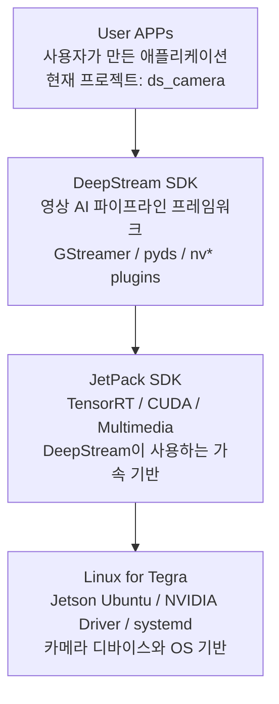

`ds_camera`는 첨부 이미지의 최상단 **User APPs** 영역에 해당함.  
DeepStream SDK 자체를 수정하는 프로젝트가 아니라, DeepStream SDK 위에 올라가는 사용자 애플리케이션임.

---

## 2. 이미지 계층과 현재 코드 매핑

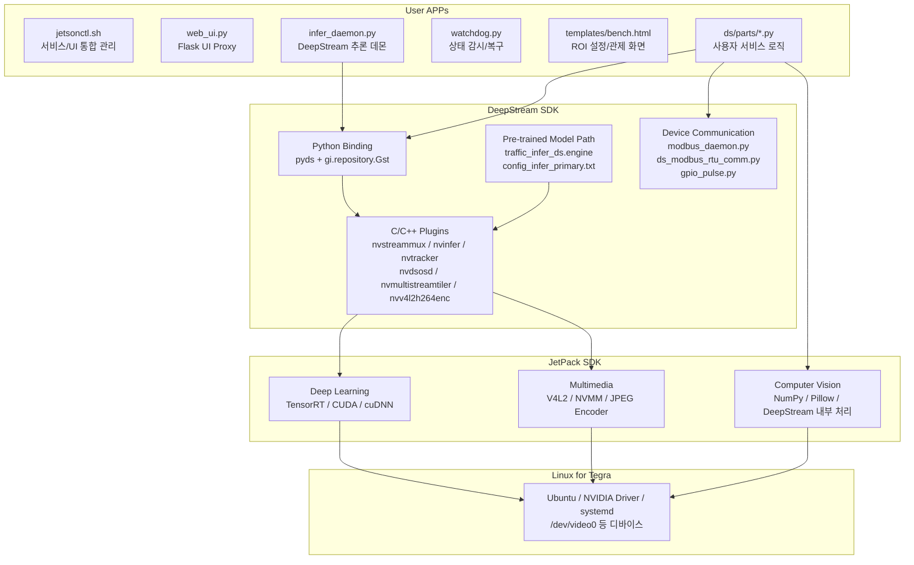

Graph Composer와 Container Builder는 현재 구조에서 사용하지 않음.  
현재는 Python 코드가 DeepStream GStreamer 파이프라인을 직접 생성하는 방식임.

---

## 3. ds_camera 전체 구조

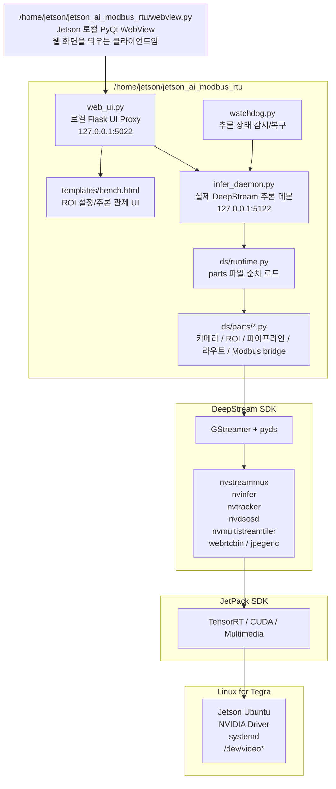

`webview.py`는 추론 서버가 아님.  
Jetson 로컬에서 `http://localhost:5022`를 띄우는 클라이언트임.

실제 서버와 추론은 `ds_camera` 내부의 `web_ui.py`, `infer_daemon.py`가 담당함.

---

## 4. 실행 프로세스 구조

현재 기본 실행 방식은 **split 모드**임.

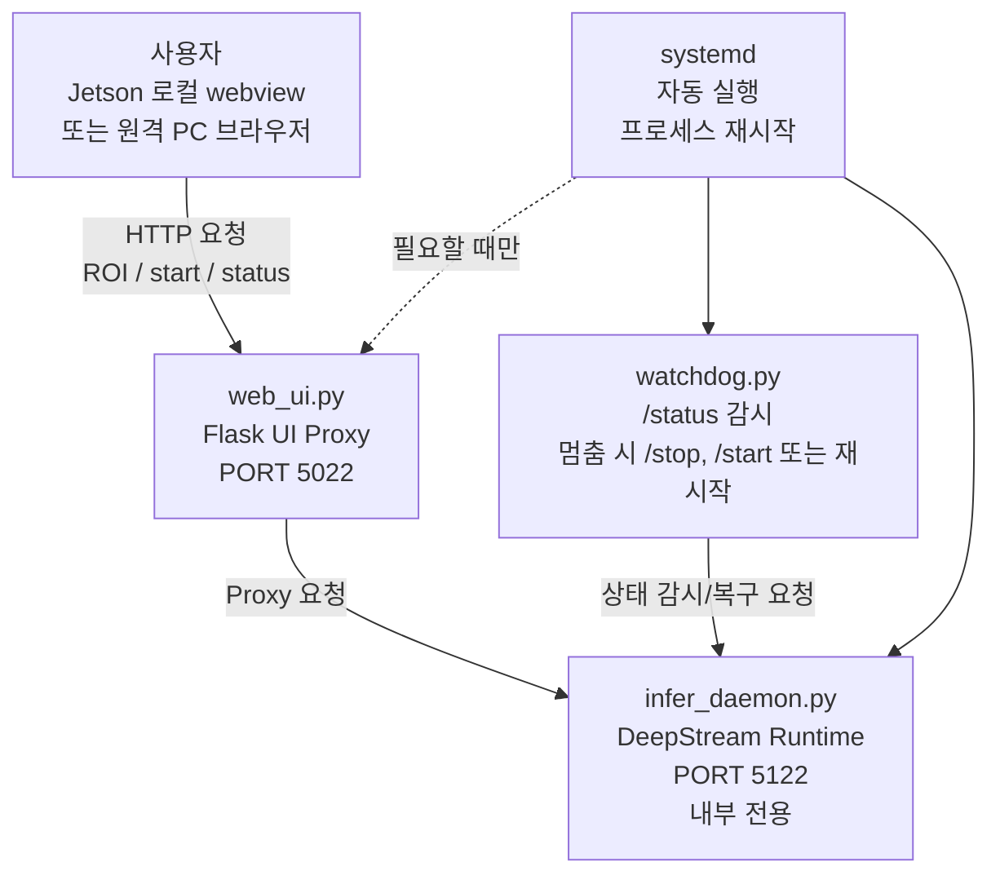

`web_ui.py`는 브라우저 요청을 받는 앞단임.  
`infer_daemon.py`는 카메라, DeepStream pipeline, ROI, 카운팅, 로컬 WebRTC/MJPEG 출력과 Modbus 연동을 소유하는 핵심 프로세스임.
`watchdog.py`는 추론 멈춤을 감지하고 복구하는 운영 안정성 프로세스임.

---

## 5. DeepStream 데이터 흐름

가로로 길게 한 줄로 늘리면 Notion에서 글자가 작아지므로 세로 흐름으로 구성함.

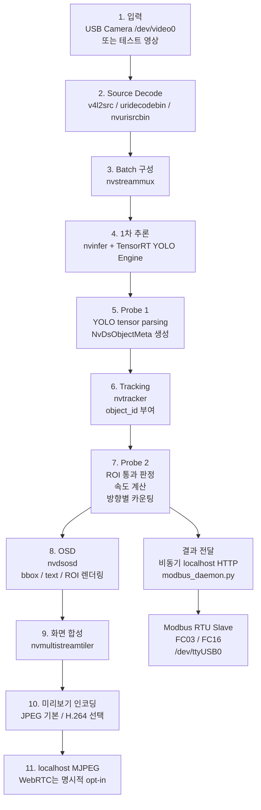

무거운 작업은 대부분 DeepStream SDK와 JetPack SDK 계층에서 수행됨.  
Python 코드는 플러그인 연결, ROI/속도/카운팅, API 라우트, 상태 관리를 담당함.

---

## 6. ds/runtime.py와 parts 구조

`ds/runtime.py`는 각 파일을 독립 import하는 구조가 아님.  
`ds/parts/*.py` 파일을 하나의 공유 네임스페이스에 순서대로 `exec()`해서 로드하는 구조임.

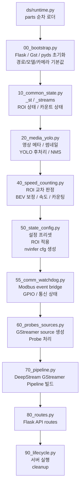

이 구조를 쓰는 이유는 GStreamer probe, Flask route, 전역 상태가 서로 강하게 연결되어 있기 때문임.  
예를 들어 `00_bootstrap.py`에서 만든 `app`, `Gst`, `pyds`, `_IS_JETSON`을 `70_pipeline.py`, `80_routes.py`가 그대로 사용함.

---

## 7. 디렉터리 구조

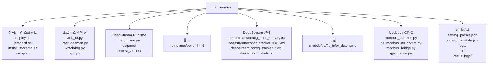

같은 작업 루트의 `/home/jetson/jetson_ai_modbus_rtu/webview.py`는 추론 서버가 아니라 로컬 GUI 클라이언트임.
Jetson 로컬 Ubuntu GUI에서 `http://localhost:5022`를 띄우는 클라이언트 실행기임.

---

## 8. ROI와 추론 상태 흐름

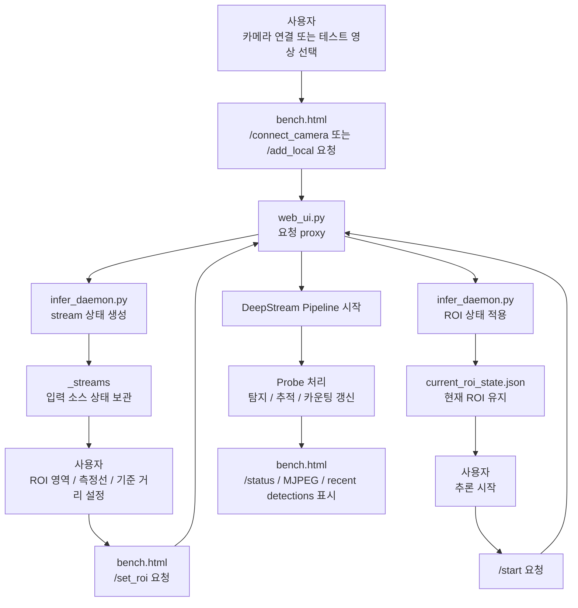

ROI는 UI에서 설정하지만, 실제 추론 중에는 `infer_daemon.py` 내부 상태와 `current_roi_state.json` 기준으로 사용됨.

---

## 9. Modbus RTU 데이터 전달 흐름

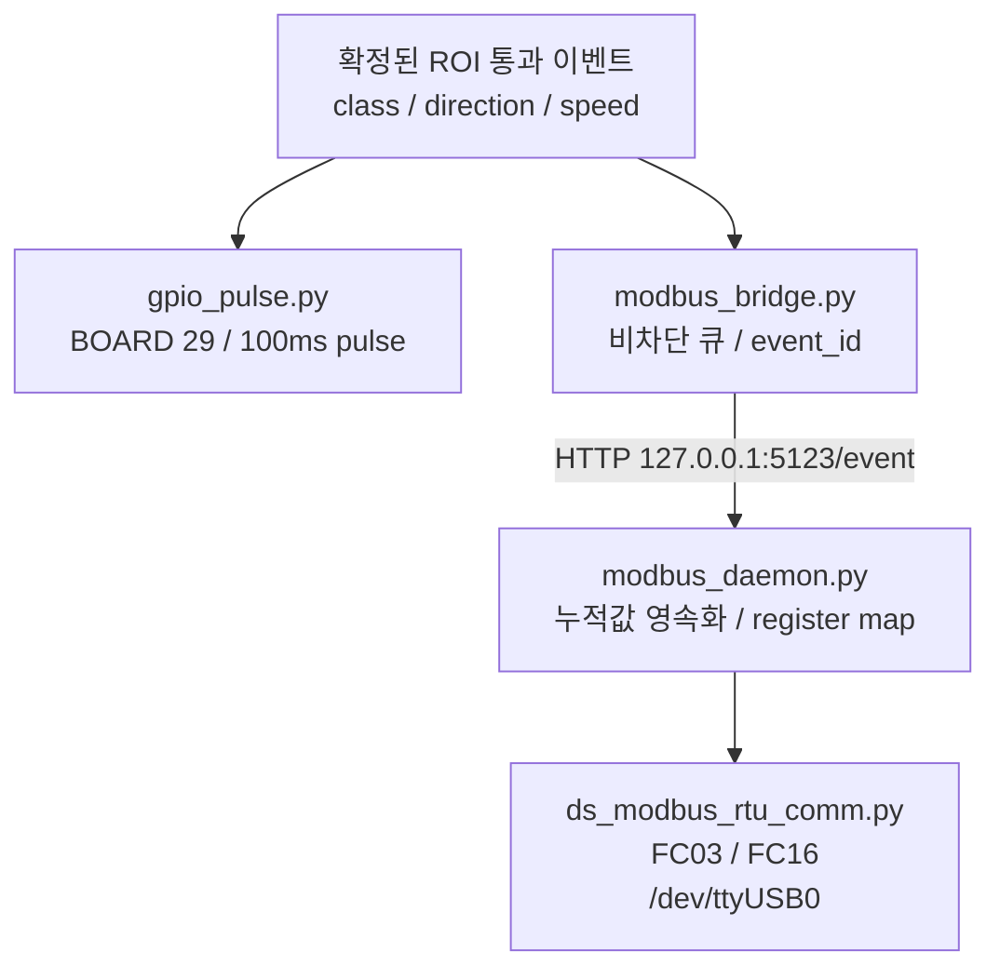

`modbus_daemon.py`가 직렬 포트와 누적 레지스터의 권위 있는 소유자임.
따라서 inferd가 재시작되는 동안에도 Modbus Slave는 살아 있고 상태 2를 응답하며,
누적값은 `run/modbus_state.json`에서 복원됨.

---

## 10. systemd 자동실행 구조

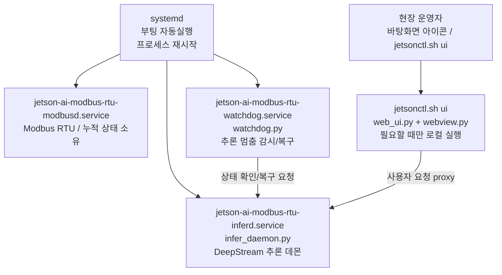

`webview.py`는 systemd 서비스에 포함되어 있지 않음.  
자동실행의 중심은 `ds_camera` 서버 3종이고, webview는 사람이 화면을 볼 때만 실행하는 클라이언트임.

---

## 11. 운영 관점에서 중요한 구분

```mermaid
flowchart TB
    subgraph MUST["추론 유지에 필수"]
        A1["infer_daemon.py<br/>DeepStream pipeline 소유"]
        A2["DeepStream Pipeline<br/>카메라 입력 / 추론 / 추적 / 카운팅"]
        A3["modbus_daemon.py<br/>직렬 통신 / 누적 상태 유지"]
    end

    subgraph STABLE["운영 안정성"]
        B1["watchdog.py<br/>추론 멈춤 감지/복구"]
    end

    subgraph VIEW["화면 확인용"]
        C1["web_ui.py<br/>브라우저와 데몬 사이 proxy"]
        C2["webview.py<br/>Jetson 로컬 GUI 클라이언트"]
        C3["브라우저/MJPEG 화면<br/>추론 현황 확인 / ROI 설정"]
    end

    A1 --> B1
    C3 --> C1
    C1 --> A1
    B1 --> A1
```

리소스를 아끼려면 운영 중에는 화면 계층을 최소화하는 구성이 적합함.

- `infer_daemon.py`: 추론을 위해 필요함
- `modbus_daemon.py`: Modbus 응답과 누적값 유지를 위해 필요함
- `watchdog.py`: 자동 복구를 위해 필요함
- `web_ui.py`: ROI 설정/상태 확인이 필요할 때 사용함
- `webview.py`: Jetson 로컬 GUI 화면을 볼 때만 사용함

---

## 12. 한 문장 요약

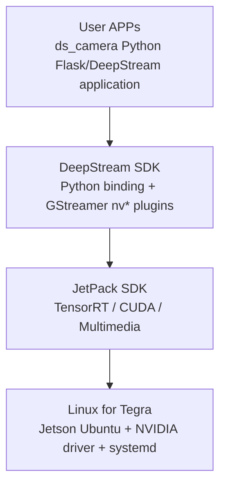

즉 `ds_camera`는 DeepStream SDK 자체를 새로 만든 것이 아님.  
DeepStream SDK와 JetPack SDK 위에 올라가는 **가로등 Edge AI용 사용자 애플리케이션**임.
